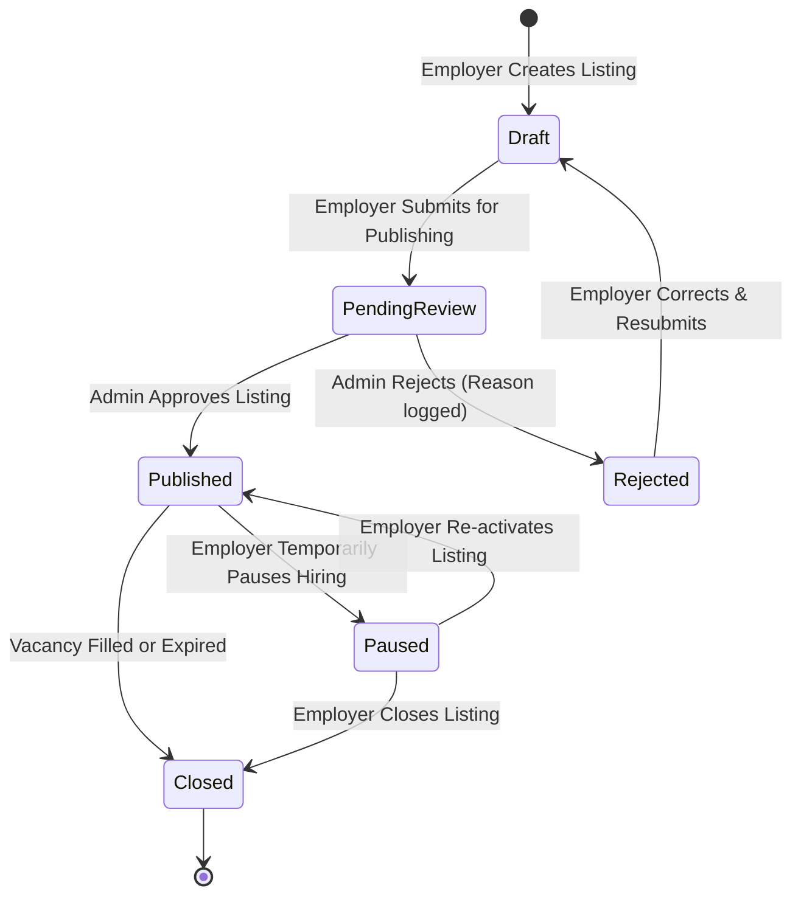
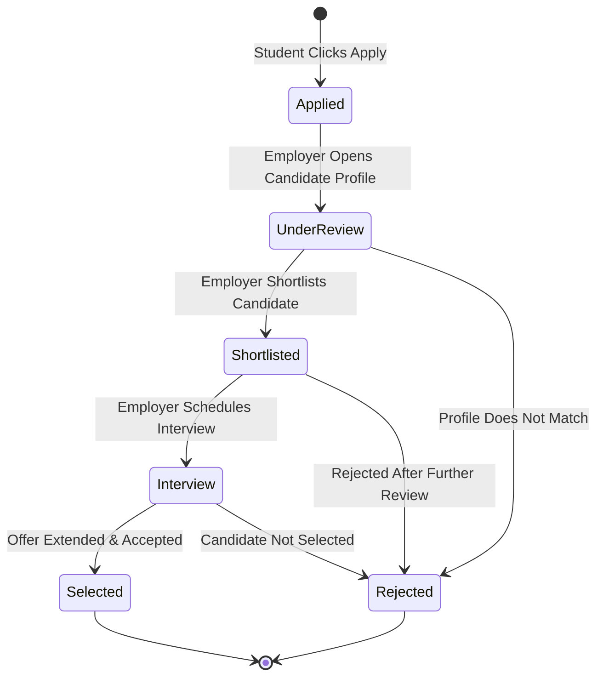

# Business Rules & System Governance Blueprint — CA Setu

**Document Version:** 1.0 (V0 Planning)  
**Product Stage:** V0 — Requirement Analysis & Product Planning  

In statutory auditing, an auditor checks internal controls and compliance rules to prevent fraud and errors. Similarly, software business rules define the inviolable constraints enforced by the backend server so the marketplace runs securely, honestly, and reliably.

---

## 1. The 10 Core Platform Business Rules

| Rule # | Business Rule Specification | System Enforcement Mechanism | CA / Audit Context |
| :---: | :--- | :--- | :--- |
| **BR-01** | **Only approved employers can publish jobs.** | If `company.isVerified !== true`, the system locks the "Publish" trigger. The job may only be saved in `Draft` state. | Prevents unverified entities, phantom firms, or fake recruiters from contacting students. |
| **BR-02** | **Only Admins can mark a company as CA Setu Verified.** | The `isVerified`, `verifiedBy`, and `verifiedAt` attributes in the `companies` collection are strictly modifiable by users where `role === 'admin'`. | Internal control principle: Segregation of Duties (SoD). No employer can self-certify. |
| **BR-03** | **A student cannot apply twice to the same job.** | Enforced via a database compound unique index `{ jobId: 1, studentProfileId: 1 }` and pre-flight validation API checks. | Prevents spamming, server bloat, and employer inbox exhaustion. |
| **BR-04** | **Closed or expired jobs cannot receive applications.** | Applications are rejected by the server if `job.status !== 'Published'` or if `Date.now() > job.expiresAt`. | Protects students from wasting time and hope on vacancies that are already filled. |
| **BR-05** | **Students can only access their own private data.** | API routes querying student profiles, resumes, and submitted applications strictly filter by the authenticated `userId`. | Data Privacy & Confidentiality (similar to client confidentiality under the CA Code of Ethics). |
| **BR-06** | **Employers can only access applicants for their own jobs.** | When querying applications, the backend forces the filter `employerId === loggedInUser.companyId`. Cross-employer inspection is blocked with HTTP 403. | Protects competitive intelligence and candidate privacy between competing CA firms. |
| **BR-07** | **Admins possess full platform governance access.** | Admins can view and moderate all collections, approve/reject companies and jobs, and arbitrate dispute reports. | Acts as the Chief Vigilance & Compliance Authority of the marketplace. |
| **BR-08** | **Every job application must have a clear, auditable status.** | Applications must strictly hold one of the 6 standardized status values. Every transition appends an entry to `statusHistory`. | Eliminates the "black hole" experience of job seekers by enforcing accountability. |
| **BR-09** | **Every job must belong strictly to a valid Category.** | Foreign key reference `categoryId` is mandatory. It must reference `'Articleship'`, `'Industrial Training'`, or `'CA Jobs'`. | Maintains clean structural taxonomy for targeted search and filtering. |
| **BR-10** | **Every published job must meet mandatory disclosure checklists.** | Title, Domain, City, Work Mode, Stipend/Salary range, Vacancies count, and Eligibility criteria must be non-empty. | Truth in advertising; ensures complete transparency before a listing is displayed. |

---

## 2. Job Lifecycle State Machine

A job listing passes through a formal lifecycle. The server permits transitions only along authorized paths:

### State Definitions & Rules:
- **`Draft`**: Editable only by the authoring employer. Invisible to public and students.
- **`Pending Review`**: Listing is locked for editing while queued in the Admin Moderation Dashboard.
- **`Published`**: Visible across public search and category feeds. Accepts incoming applications.
- **`Paused`**: Visible in search marked as *"Applications Paused"*. "Apply" button disabled.
- **`Closed`**: Marked as *"Position Filled"*. No further applications permitted.
- **`Rejected`**: Not public. Returned to employer with specific feedback (e.g., *"Stipend below ICAI mandatory guidelines"*).

---

## 3. Application Lifecycle State Machine

Applications submitted by students progress through sequential stages:

### Permitted Status Definitions:
1. **`Applied`**: Initial default state immediately upon submission.
2. **`Under Review`**: Automatically triggered the first time the hiring employer opens and inspects the candidate's detailed profile or resume.
3. **`Shortlisted`**: Employer signals strong interest; student moves into the primary candidate shortlist.
4. **`Interview`**: Employer invites student for written assessment, technical test, or partner interview.
5. **`Selected`**: Employer extends an official articleship or job offer.
6. **`Rejected`**: Candidate is respectfully notified that the firm is moving forward with other applicants.

---

## 4. Role-Based Access Control (RBAC) Matrix

This table specifies what actions each user role is permitted to perform across the platform's core data modules:

| Resource / Action | Guest (Public) | Student | Employer | Admin |
| :--- | :---: | :---: | :---: | :---: |
| **Browse Published Jobs** | ✅ Read | ✅ Read | ✅ Read | ✅ Read |
| **Browse Companies Directory** | ✅ Read | ✅ Read | ✅ Read | ✅ Read |
| **Create Student Profile** | ❌ Blocked | ✅ Create / Edit Own | ❌ Blocked | ✅ Full Access |
| **Upload Resume** | ❌ Blocked | ✅ Upload Own | ❌ Blocked | ✅ Full Access |
| **Save Jobs (Bookmarks)** | ❌ Blocked | ✅ Manage Own | ❌ Blocked | ❌ N/A |
| **Submit Job Application** | ❌ Blocked | ✅ Apply Once | ❌ Blocked | ❌ N/A |
| **Track Submitted Applications** | ❌ Blocked | ✅ View Own Status | ❌ Blocked | ✅ Audit All |
| **Create Company Profile** | ❌ Blocked | ❌ Blocked | ✅ Create / Edit Own | ✅ Full Access |
| **Submit Verification Documents**| ❌ Blocked | ❌ Blocked | ✅ Upload Own | ✅ Full Access |
| **Verify Company Badge** | ❌ Blocked | ❌ Blocked | ❌ Blocked | ✅ **Sole Authority** |
| **Post Job Vacancies** | ❌ Blocked | ❌ Blocked | ✅ Post for Own Firm | ✅ Full Access |
| **Approve / Publish Jobs** | ❌ Blocked | ❌ Blocked | ❌ Blocked (Draft only)| ✅ **Sole Authority** |
| **View Received Applicants** | ❌ Blocked | ❌ Blocked | ✅ Own Jobs Only | ✅ Full Access |
| **Change Applicant Status** | ❌ Blocked | ❌ Blocked | ✅ Own Applicants | ✅ Full Access |
| **Submit Abuse Report** | ❌ Blocked | ✅ Create | ✅ Create | ✅ Resolve & Close |
| **Platform Governance Dashboard**| ❌ Blocked | ❌ Blocked | ❌ Blocked | ✅ **Exclusive** |

---

## 5. CA-Specific Regulatory & Integrity Guardrails

To protect the reputation of CA Setu within the professional community, the platform incorporates domain-specific compliance checks:

### 5.1 ICAI Firm Registration Number (FRN) Validation
- Format validation for Indian CA Firm Registration Numbers (e.g., 6 numeric digits followed by an uppercase letter, like `123456N`, or LLPIN format for Limited Liability Partnerships).
- Duplicate FRN rejection: No two employer accounts can claim the same FRN simultaneously without admin manual review.

### 5.2 Minimum Stipend Advisory
- Under ICAI guidelines (Chartered Accountants Regulations), firms are legally bound to pay minimum monthly stipends to articled assistants based on the population of the city or town.
- During job posting, the system alerts employers if the proposed stipend is below the ICAI statutory threshold, preventing exploitation of CA trainees.

### 5.3 Attempt Count & Transparency
- Students can optionally declare their attempt count. If provided, employers can filter candidates who cleared on their 1st or 2nd attempt, while students with multiple attempts can highlight proven skills (e.g., Advanced Excel, GST litigation, PowerBI) to stand out on merit.
