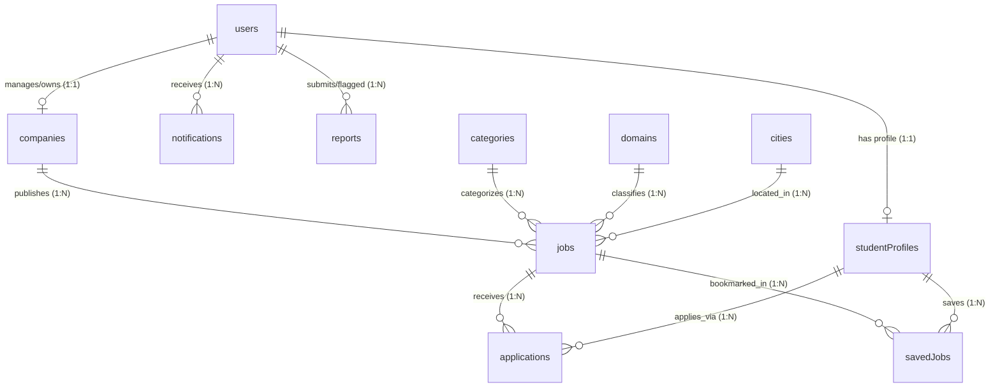

# Database Architecture & Collections Blueprint — CA Setu

**Document Version:** 1.0 (V0 Planning)  
**Product Stage:** V0 — Requirement Analysis & Product Planning  
**Target Database:** MongoDB (NoSQL Document Store)  

---

## 1. Database Concepts Explained for Finance & Accounting Professionals

In traditional accounting, an organization maintains a **General Ledger** composed of specialized **Registers** (such as the Sales Register, Purchase Register, and Fixed Asset Register).

In modern software:
- The entire database is the **Master Book of Accounts**.
- A **Collection** is an individual **Register** (e.g., the `users` register, the `jobs` register).
- A **Document** is a **Single Voucher or Entry** inside that register.
- A **Field** is a **Specific Column** in that voucher (e.g., Party Name, GSTIN, Amount, Date).
- An **ObjectId / Reference** is like a **Folio Reference Number** (it links a transaction in the Cash Book to an exact entry in the Creditor Ledger).

---

## 2. Entity-Relationship Diagram (ERD)

The following diagram illustrates how the 11 collections link to one another via reference IDs:

---

## 3. Detailed Collection Schemas (11 Collections)

### 3.1 Collection: `users`
**Purpose:** Master authentication and role registry. Stores login credentials and account permissions.

| Field Name | Type | Constraints | Description & CA Analogy |
| :--- | :--- | :--- | :--- |
| `_id` | ObjectId | Primary Key | Auto-generated unique voucher ID for the user account. |
| `name` | String | Required, Trim | Full legal name of the individual or primary representative. |
| `email` | String | Required, Unique, Lowercase | Unique login ID (equivalent to an entity's primary registered email). |
| `passwordHash` | String | Required | Secure cryptographic hash (vault-locked; never stored in plain text). |
| `role` | String (Enum) | Required, Default: `'student'` | Access privilege: `'student'`, `'employer'`, or `'admin'`. |
| `phone` | String | Optional, Trim | Contact telephone number. |
| `isActive` | Boolean | Default: `true` | Account active status (toggleable to false if suspended/banned). |
| `createdAt` | Date | Default: `Date.now` | Date and time when the account was opened. |
| `updatedAt` | Date | Default: `Date.now` | Last timestamp when credentials or info were modified. |

---

### 3.2 Collection: `studentProfiles`
**Purpose:** Comprehensive student record containing CA-specific academic achievements, resume links, and preferences.

| Field Name | Type | Constraints | Description & CA Analogy |
| :--- | :--- | :--- | :--- |
| `_id` | ObjectId | Primary Key | Unique student profile identifier. |
| `userId` | ObjectId (Ref) | Required, Unique, Ref: `users` | Reference link to the parent user account. |
| `icaiRegistrationNumber` | String | Optional, Trim, Uppercase | Student Registration Number (SRN), e.g., `WRO0123456` or `NRO0654321`. |
| `caStage` | String (Enum) | Required | Academic milestone: `'Inter'`, `'Final'`, or `'Qualified'`. |
| `groupsCleared` | String (Enum) | Required | Examination clearance: `'Both Groups'`, `'Group 1 Only'`, `'Group 2 Only'`. |
| `attemptsCount` | Number | Optional, Min: 1 | Number of attempts taken to clear the respective stage. |
| `passingYearMonth` | String | Optional | Month and Year of qualifying examination (e.g., `'Nov 2025'`). |
| `articleshipEligibilityDate`| Date | Optional | Date from which student is eligible to begin practical training. |
| `preferredDomains` | Array of Strings | Optional | List of interest areas (e.g., `['Statutory Audit', 'Direct Tax']`). |
| `preferredCities` | Array of Strings | Optional | Target work locations (e.g., `['Mumbai', 'Pune']`). |
| `resumeUrl` | String | Optional | Secure cloud URL where the student's PDF resume is hosted. |
| `bio` | String | Optional, Max: 500 chars | Brief professional summary or introduction. |
| `skills` | Array of Strings | Optional | Technical tools known (e.g., `['Advanced Excel', 'Tally Prime', 'SAP']`). |
| `createdAt` | Date | Default: `Date.now` | Profile creation timestamp. |
| `updatedAt` | Date | Default: `Date.now` | Last profile update timestamp. |

---

### 3.3 Collection: `companies`
**Purpose:** Employer / CA Firm Master Register containing verification data, firm classification, and compliance credentials.

| Field Name | Type | Constraints | Description & CA Analogy |
| :--- | :--- | :--- | :--- |
| `_id` | ObjectId | Primary Key | Unique company record identifier. |
| `userId` | ObjectId (Ref) | Required, Unique, Ref: `users` | Account administrator managing this firm profile. |
| `companyName` | String | Required, Trim | Registered legal name of the firm or corporate entity. |
| `firmType` | String (Enum) | Required | Classification: `'Sole Proprietorship'`, `'Partnership / LLP'`, `'Top 20 National Firm'`, `'Big 4 / Big 6'`, `'Corporate / MNC'`. |
| `registrationNumber` | String | Required, Unique | ICAI Firm Registration Number (FRN) or Corporate CIN. |
| `headquartersCity` | String | Required | Primary city of the principal place of business. |
| `officeAddress` | String | Required | Full registered office address. |
| `partnerNames` | Array of Strings | Optional | Names of managing partners or hiring directors. |
| `website` | String | Optional | Official corporate website URL. |
| `logoUrl` | String | Optional | Brand logo image URL. |
| `isVerified` | Boolean | Default: `false` | **CA Setu Verified Status**. Only admin can toggle to `true`. |
| `verificationDocumentUrl` | String | Optional | Uploaded ICAI Constitution Certificate or RoC Incorporation Certificate. |
| `verifiedBy` | ObjectId (Ref) | Optional, Ref: `users` | ID of the specific Admin who inspected and approved the firm. |
| `verifiedAt` | Date | Optional | Timestamp when verification approval was granted. |
| `createdAt` | Date | Default: `Date.now` | Date when company registered on the platform. |

---

### 3.4 Collection: `jobs`
**Purpose:** Central job registry storing all vacancy details, eligibility rules, and publication status.

| Field Name | Type | Constraints | Description & CA Analogy |
| :--- | :--- | :--- | :--- |
| `_id` | ObjectId | Primary Key | Unique job vacancy reference. |
| `companyId` | ObjectId (Ref) | Required, Ref: `companies` | The hiring entity offering this opportunity. |
| `title` | String | Required, Trim | Job title (e.g., *"Articleship Trainee — Statutory Audit & Assurance"*). |
| `categoryId` | ObjectId (Ref) | Required, Ref: `categories` | Category link: `'Articleship'`, `'Industrial Training'`, or `'CA Jobs'`. |
| `domainId` | ObjectId (Ref) | Required, Ref: `domains` | Domain link (e.g., `'Statutory Audit'`, `'Valuation'`). |
| `cityId` | ObjectId (Ref) | Required, Ref: `cities` | Location link (e.g., `'Mumbai'`, `'Bengaluru'`). |
| `workMode` | String (Enum) | Required, Default: `'On-site'` | Work environment: `'On-site'`, `'Hybrid'`, or `'Remote'`. |
| `stipendOrSalary` | Object | Required | `{ min: Number, max: Number, period: 'Monthly' \| 'Per Annum', currency: 'INR' }`. |
| `openVacancies` | Number | Default: 1, Min: 1 | Number of available open positions. |
| `requiredGroups` | String (Enum) | Required | Minimum requirement: `'Both Groups'`, `'Group 1'`, `'Group 2'`, `'Either Group'`. |
| `maxAttemptsAllowed` | Number | Optional | Maximum allowed exam attempts (if restricted by firm). |
| `description` | String | Required | Detailed responsibilities, exposure, and team structure. |
| `status` | String (Enum) | Required, Default: `'Draft'` | Status: `'Draft'`, `'Pending Review'`, `'Published'`, `'Paused'`, `'Closed'`, `'Rejected'`. |
| `isFeatured` | Boolean | Default: `false` | Highlighted badge for premium visibility. |
| `publishedAt` | Date | Optional | Timestamp when listing went live publicly. |
| `expiresAt` | Date | Optional | Application deadline timestamp. |
| `createdAt` | Date | Default: `Date.now` | Creation date. |

---

### 3.5 Collection: `applications`
**Purpose:** Transaction ledger recording every application submitted by a student to a job.

| Field Name | Type | Constraints | Description & CA Analogy |
| :--- | :--- | :--- | :--- |
| `_id` | ObjectId | Primary Key | Unique application transaction reference. |
| `jobId` | ObjectId (Ref) | Required, Ref: `jobs` | Target job vacancy. |
| `studentProfileId` | ObjectId (Ref) | Required, Ref: `studentProfiles` | Applying candidate record. |
| `employerId` | ObjectId (Ref) | Required, Ref: `companies` | Target hiring firm (indexed for instant employer queries). |
| `resumeSnapshotUrl` | String | Required | Snapshot URL of resume as submitted at the moment of application. |
| `coverNote` | String | Optional, Max: 1000 chars | Personal message or introduction from the candidate. |
| `status` | String (Enum) | Required, Default: `'Applied'` | Current stage: `'Applied'`, `'Under Review'`, `'Shortlisted'`, `'Interview'`, `'Selected'`, `'Rejected'`. |
| `statusHistory` | Array of Objects | Default: `[]` | Audit trail: `[{ status: String, changedAt: Date, note: String }]`. |
| `employerNotes` | String | Optional | Confidential internal notes accessible only to the hiring employer. |
| `createdAt` | Date | Default: `Date.now` | Submission timestamp. |

> [!IMPORTANT]
> **Unique Compound Index:** A compound unique index on `{ jobId: 1, studentProfileId: 1 }` guarantees by system architecture that a student can never submit more than one application to the same job listing.

---

### 3.6 Collection: `savedJobs`
**Purpose:** Personal bookmark ledger for students.

| Field Name | Type | Constraints | Description |
| :--- | :--- | :--- | :--- |
| `_id` | ObjectId | Primary Key | Unique bookmark record. |
| `studentProfileId` | ObjectId (Ref) | Required, Ref: `studentProfiles` | Student who saved the job. |
| `jobId` | ObjectId (Ref) | Required, Ref: `jobs` | Saved job reference. |
| `createdAt` | Date | Default: `Date.now` | Timestamp when saved. |

---

### 3.7 Collection: `categories`
**Purpose:** Master classification table for the 3 core opportunity streams.

| Field Name | Type | Constraints | Sample Records |
| :--- | :--- | :--- | :--- |
| `_id` | ObjectId | Primary Key | Standard record ID. |
| `name` | String | Required, Unique | `'Articleship'`, `'Industrial Training'`, `'CA Jobs'`. |
| `slug` | String | Required, Unique | `'articleship'`, `'industrial-training'`, `'ca-jobs'`. |
| `description` | String | Optional | Informational summary explaining the category. |
| `isActive` | Boolean | Default: `true` | Active status toggle. |

---

### 3.8 Collection: `domains`
**Purpose:** Master registry of finance, accounting, and advisory specializations.

| Field Name | Type | Constraints | Sample Records |
| :--- | :--- | :--- | :--- |
| `_id` | ObjectId | Primary Key | Standard record ID. |
| `name` | String | Required, Unique | `'Statutory Audit'`, `'Transfer Pricing'`, `'Investment Banking'`, `'FP&A'`, etc. |
| `slug` | String | Required, Unique | URL-safe slug (e.g., `'statutory-audit'`, `'investment-banking'`). |
| `applicableCategories` | Array of ObjectIds | Ref: `categories` | Links indicating whether domain applies to Articleship, Industrial, or Jobs. |
| `isActive` | Boolean | Default: `true` | Active status toggle. |

---

### 3.9 Collection: `cities`
**Purpose:** Standardized geographical registry ensuring consistent search filters.

| Field Name | Type | Constraints | Sample Records |
| :--- | :--- | :--- | :--- |
| `_id` | ObjectId | Primary Key | Standard record ID. |
| `name` | String | Required, Unique | `'Mumbai'`, `'Delhi NCR'`, `'Bengaluru'`, `'Kolkata'`, `'Chennai'`, `'Ahmedabad'`, etc. |
| `state` | String | Required | State name (e.g., `'Maharashtra'`, `'Gujarat'`). |
| `tier` | String (Enum) | Default: `'Tier 1'` | `'Metro'`, `'Tier 1'`, `'Tier 2'`, `'Tier 3'`. |
| `isActive` | Boolean | Default: `true` | Active status toggle. |

---

### 3.10 Collection: `notifications`
**Purpose:** Real-time event log alerting users of status changes and approvals.

| Field Name | Type | Constraints | Description |
| :--- | :--- | :--- | :--- |
| `_id` | ObjectId | Primary Key | Unique notification ID. |
| `recipientId` | ObjectId (Ref) | Required, Ref: `users` | User receiving the message. |
| `title` | String | Required | Brief summary (e.g., *"Application Shortlisted"*). |
| `message` | String | Required | Body text (e.g., *"K.S. & Associates has shortlisted your profile for Statutory Audit."*). |
| `actionLink` | String | Optional | Target URL (e.g., `'/student/applications'`). |
| `isRead` | Boolean | Default: `false` | Read/unread flag. |
| `createdAt` | Date | Default: `Date.now` | Notification timestamp. |

---

### 3.11 Collection: `reports`
**Purpose:** Safety and moderation ledger for reporting fraudulent firms, misleading stipends, or inappropriate listings.

| Field Name | Type | Constraints | Description |
| :--- | :--- | :--- | :--- |
| `_id` | ObjectId | Primary Key | Unique incident record. |
| `reporterId` | ObjectId (Ref) | Required, Ref: `users` | User lodging the complaint. |
| `targetType` | String (Enum) | Required | Subject being flagged: `'Job'` or `'Company'`. |
| `targetId` | ObjectId | Required | ID of the reported job or company. |
| `reason` | String | Required | Reason category (e.g., `'Sub-minimum stipend'`, `'Fake firm'`, `'Spam'`). |
| `details` | String | Optional | Detailed narrative explaining the complaint. |
| `status` | String (Enum) | Default: `'Pending'` | Investigation status: `'Pending'`, `'Investigating'`, `'Resolved'`, `'Dismissed'`. |
| `adminNotes` | String | Optional | Action notes entered by the investigating Admin. |
| `createdAt` | Date | Default: `Date.now` | Report lodgment timestamp. |
