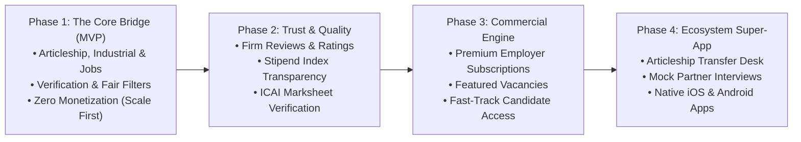

# Strategic Roadmap & Future Expansion Vision — CA Setu

**Document Version:** 1.0 (V0 Planning)  
**Product Stage:** V0 — Requirement Analysis & Product Planning  

While our immediate focus is executing the **Version 0 to Version 6 MVP**, this document outlines the long-term strategic trajectory of CA Setu as it scales from an articleship job board into a comprehensive career ecosystem for finance professionals.

---

## 1. Multi-Phase Evolution Horizon

---

## 2. Phase Breakdown & Feature Horizons

### Phase 1: The Core Bridge (Current MVP Scope)
- **Primary Goal:** Solve the immediate pain point of fragmented articleship, industrial training, and CA hiring.
- **Key Features:**
  - Robust 3-tier MERN stack foundation.
  - Multi-facet search tailored to CA Inter/Final attempts and groups.
  - Manual Admin verification of CA firm credentials (FRN/CIN).
  - Clean application tracker (`Applied` → `Selected`).
  - 100% Free access for all participants to build liquidity and word-of-mouth adoption.

---

### Phase 2: Trust, Transparency & Reputation (Month 4 – Month 8)
- **Primary Goal:** Eliminate information asymmetry between students and CA firms.
- **Key Features:**
  - **Glassdoor for CA Firms (Anonymous Articleship Reviews):** Verified articleship alumni can review firms on work culture, exam leave policy, outstation audit allowances, and exposure quality (Stat Audit vs Routine Tax return filing).
  - **The CA Setu Stipend Index:** Real-time benchmark report publishing average articleship and industrial training stipends across cities and domains, promoting fair compensation.
  - **Student Verified Badge:** Students can upload their official ICAI pass marksheets to earn a "Verified Ranker" or "Both Groups First Attempt" trust badge on their profile.
  - **WhatsApp Alert Gateway:** Instant WhatsApp notifications when an application status changes to `Shortlisted` or `Interview`.

---

### Phase 3: Monetization & Enterprise Employer Suite (Month 9 – Month 15)
- **Primary Goal:** Achieve operational profitability and sustainable recurring revenue.
- **Monetization Streams:**
  1. **Featured Job Listings (Pay-per-Post):** Employers can pay ₹1,499 – ₹2,999 to pin their vacancy to the top of category feeds for 14 days with high-visibility badges.
  2. **Employer Pro Subscription (SaaS model):** Monthly/Annual subscription for growing mid-sized firms and corporate MNCs offering:
     - Unlimited active job postings.
     - Direct access to candidate database search (pre-screened resume bank).
     - Multi-user HR team access under one firm account.
  3. **Targeted Campus Recruitment Drives:** Virtual hiring fairs conducted in the 30-day window following ICAI result declarations.

---

### Phase 4: CA Ecosystem Super-App (Month 16+)
- **Primary Goal:** Accompany a Chartered Accountant throughout their entire 35-year professional lifecycle.
- **Strategic Expansions:**
  - **Articleship Transfer Assistance Desk:** Structured marketplace for students seeking genuine 1st-year transfer (under ICAI Regulation 56 permitted grounds) to switch domains.
  - **Mentorship & Mock Interviews:** Connect students with newly qualified CAs working at Big 4 and Investment Banks for 1-on-1 mock technical interviews and resume reviews.
  - **Native Mobile Applications:** Dedicated iOS and Android apps distributed via Apple App Store and Google Play Store with native push notifications.
  - **CPE & Upskilling Hub:** Integration with specialized courses (Financial Modeling, Alteryx, Forensic Audit, International Tax).
