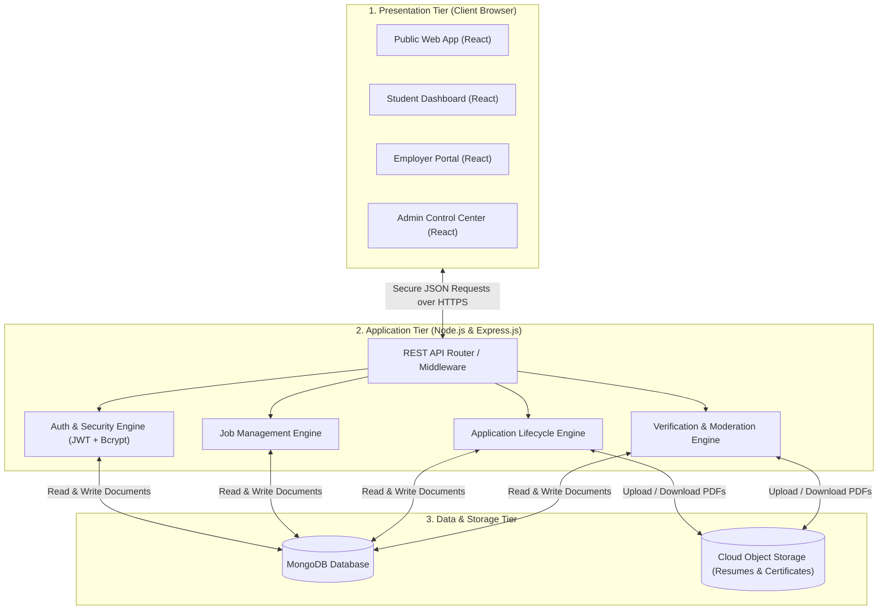
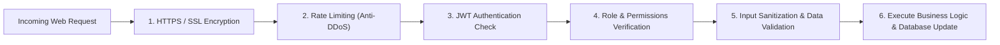

# Technical Architecture Blueprint — CA Setu

**Document Version:** 1.0 (V0 Planning)  
**Product Stage:** V0 — Requirement Analysis & Product Planning  
**Target Architecture:** MERN Stack (MongoDB, Express.js, React.js, Node.js)  

---

## 1. System Architecture Overview

The CA Setu platform follows a modern, decoupled **3-Tier Architecture**:
1. **Presentation Tier (Frontend):** React.js single-page application running in the user's web browser.
2. **Application / Logic Tier (Backend):** Node.js and Express.js REST API server handling business logic, permissions, and workflow orchestration.
3. **Data Tier (Storage):** MongoDB document database for structured records, paired with Cloud Object Storage for resumes and compliance documents.

---

## 2. The MERN Stack Explained for Finance Professionals

To a Chartered Accountant or Finance Director, choosing a technology stack is like choosing an accounting software ecosystem (e.g., SAP, Oracle Financials, or Tally Prime). The **MERN Stack** is the industry standard for scalable modern web platforms:

### 2.1 M — MongoDB (The General Ledger Storage)
- **What it is:** A flexible, high-performance NoSQL database that stores data in JSON-like documents (instead of rigid SQL rows and columns).
- **Why it fits CA Setu:** CA profiles have diverse, evolving data attributes (e.g., different attempt counts, varying ICAI curriculum schemes, multiple skill tags). MongoDB handles dynamic profiles seamlessly without expensive database rebuilds.

### 2.2 E — Express.js (The Internal Audit & Routing Controller)
- **What it is:** A fast, minimalist web framework that sits inside Node.js.
- **Why it fits CA Setu:** Express acts as the gatekeeper. When a student clicks "Apply", Express checks: Is the student logged in? Have they already applied? Is the job still open? If yes, it routes the voucher forward; if no, it blocks the transaction with an audit error.

### 2.3 R — React.js (The Front Office & User Interface)
- **What it is:** A user-interface library developed by Meta (Facebook) that creates lightning-fast, reactive screens.
- **Why it fits CA Setu:** In traditional websites, clicking a filter reloads the entire page. In React, filtering by "Mumbai" or "Statutory Audit" instantly updates the job cards without reloading the screen, delivering a snappy, mobile-app-like experience.

### 2.4 N — Node.js (The Back-Office Processing Engine)
- **What it is:** A server runtime environment that runs JavaScript on the server.
- **Why it fits CA Setu:** Node.js uses an asynchronous, event-driven engine capable of handling thousands of simultaneous connections (e.g., during ICAI result declaration days when thousands of students search for articleship simultaneously) with minimal server hardware cost.

---

## 3. Communication Mechanism: REST APIs

### How Does the Screen Talk to the Database?
The Frontend and the Backend do not run in the same place. The Frontend runs on the student's mobile or laptop browser. The Backend runs on a secured cloud server.

They communicate using **RESTful APIs** (Application Programming Interfaces):
- Think of an API like an official bank challan or instruction memo:
  - **`GET /api/jobs`**: *"Please return a list of active articleship jobs in Mumbai."*
  - **`POST /api/applications`**: *"Please submit an application for Student ID #101 to Job #504."*
  - **`PUT /api/companies/:id/verify`**: *"Admin instruction to mark Company #20 as Verified."*
- All messages are exchanged in **JSON** (JavaScript Object Notation), which is a clean, structured text format easily read by computers.

---

## 4. File Storage Architecture: PDF Resumes & Certificates

> [!CAUTION]
> **A Classic Architectural Mistake:** Never store large binary files (like 5MB PDF resumes or scanned firm registration certificates) directly inside the database. Doing so causes the database to bloat, slowing down searches and inflating hosting bills.

### The Best-Practice Strategy:
1. When a student uploads their resume, the PDF is sent directly to dedicated **Cloud Object Storage** (such as AWS S3, Google Cloud Storage, or Cloudinary).
2. The cloud storage saves the PDF securely and returns a unique, tamper-proof **URL link**.
3. Only this light text URL (e.g., `https://storage.casetu.com/resumes/aman-sharma-2026.pdf`) is recorded in the `studentProfiles` database collection.
4. Access to private student resumes is protected by expiring signed URLs, ensuring unauthorized third parties cannot scrape candidate resumes.

---

## 5. Security & Internal Controls Architecture

Just as financial platforms require strict internal controls, CA Setu enforces defense-in-depth security:

1. **HTTPS / SSL:** All traffic between the browser and server is encrypted, protecting credentials from network interception.
2. **Rate Limiting:** Prevents malicious bots from spamming the login or search endpoints.
3. **JWT (JSON Web Tokens):** When a user logs in with valid credentials, the server issues a cryptographically signed digital token. The user sends this token with subsequent requests to prove their identity without re-sending their password.
4. **Bcrypt Password Hashing:** User passwords are never saved in clear text. They are hashed using `bcrypt` with a minimum salt work factor of 10. Even if an attacker were to read the database, they cannot reverse the hashes into actual passwords.
5. **CORS (Cross-Origin Resource Sharing):** Locks down the API so that only requests originating from the official CA Setu frontend domain are accepted.

---

## 6. Deployment & Environment Strategy

To prevent experimental bugs from impacting real students and firms, we maintain three separate operating environments:

| Environment | Purpose | Access | Database |
| :--- | :--- | :--- | :--- |
| **Development (`localhost`)** | For writing and testing code on the developer's workstation. | Developers only | Local / Test Sandbox |
| **Staging (`staging.casetu.com`)** | Exact replica of the live site used for UAT (User Acceptance Testing) and review by the Product Owner. | Internal Team & QA | Staging Database (Mock data) |
| **Production (`casetu.com`)** | The live, public platform serving real students, CA firms, and corporate employers. | Public & Users | Production MongoDB Cluster (Encrypted & Backed up) |
