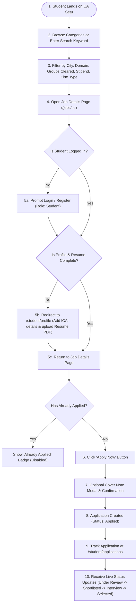
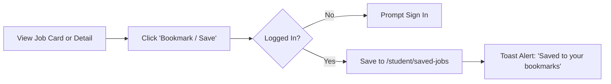
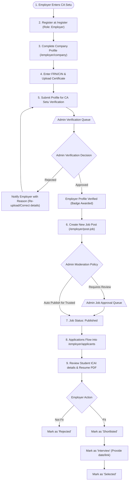
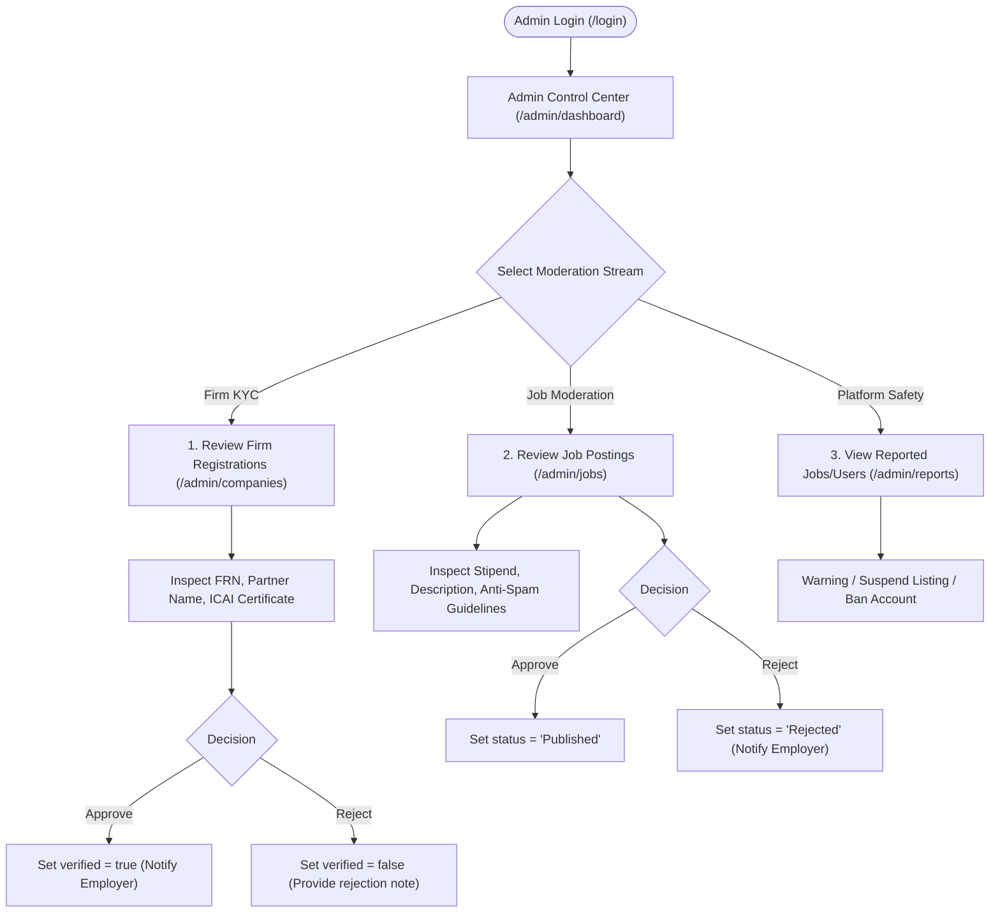

# User Flows & System Interaction Blueprints — CA Setu

**Document Version:** 1.0 (V0 Planning)  
**Product Stage:** V0 — Requirement Analysis & Product Planning  

This document visualizes the exact step-by-step pathways for the three primary user roles: **Student**, **Employer**, and **Admin**, including normal paths and critical exception flows.

---

## 1. Student User Flows

### 1.1 Complete End-to-End Student Journey

The journey begins from public discovery to application tracking and eventual selection:

---

### 1.2 Student Saved Jobs Flow

Students frequently research multiple openings before submitting applications:

---

## 2. Employer User Flows

### 2.1 Complete Employer Onboarding & Hiring Lifecycle

Employers must be verified before their listings are visible to students:

---

## 3. Administrator Governance Flows

The platform Admin ensures trust, data validity, and safety across the ecosystem:

---

## 4. Exception & Edge Case Workflows

Handling edge cases cleanly prevents user frustration and system errors:

| Edge Case Scenario | Trigger Condition | System Behavior & User Experience |
| :--- | :--- | :--- |
| **Unverified Employer attempts to post a job** | Employer tries to access `/employer/post-job` while `isVerified == false`. | Job posting form allows drafting, but publishing button is locked with message: *"Your firm verification is currently in progress. You can save drafts, but listings will go live once verified by Admin."* |
| **Student attempts duplicate application** | Student clicks "Apply Now" on a job they previously applied to. | Frontend displays disabled button labeled **"Applied on [Date]"**. Backend API rejects any repeated POST with HTTP `409 Conflict`. |
| **Student applies with incomplete profile** | Student clicks "Apply", but `studentProfile` lacks resume PDF or ICAI Registration Number. | Intercepted with a modal: *"Please complete your CA details and upload your resume before applying."* with a one-click redirect to `/student/profile`. |
| **Job expires or closes while student is applying** | Employer changes job status to `Closed` or deadline elapses while student has the page open. | When student hits "Submit Application", system validates job status. Displays: *"This vacancy has just been closed by the employer and is no longer accepting submissions."* |
| **Guest bookmarks a job** | Non-logged-in user clicks the "Bookmark" icon on a job card. | Saves the job ID to local storage temporarily and redirects to `/login?redirect=/jobs/:id`. Upon successful login, syncs bookmark to database. |
| **Firm Registration Number (FRN) duplicate check** | An employer tries to register with an FRN that already exists in the system. | System alerts: *"This ICAI Firm Registration Number is already registered. If you are an authorized partner, contact support@casetu.com."* |
